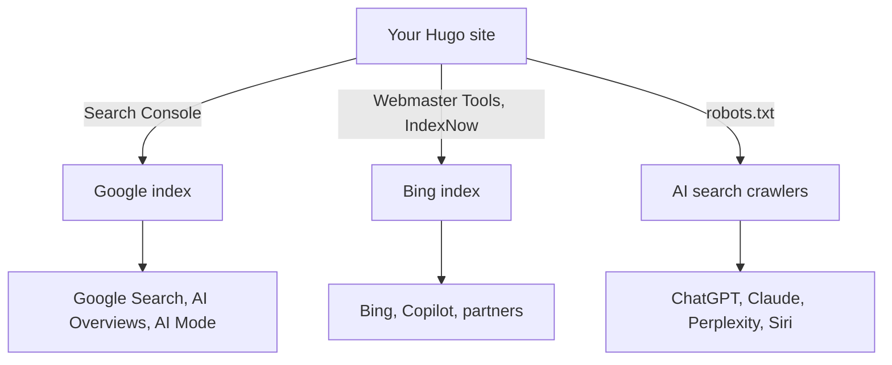

Ryan asked for one guide to getting found in 2026. It should cover the search consoles, what "GEO" really means, the technical work on a Hugo site, and getting a client's business onto Google Maps. This is that guide. It's written for someone who knows Google Search Console and little else.

Most of it comes from the search engines' own documentation, read in November 2026, and it's footnoted. Plenty of SEO advice online is guesswork, and Google now publishes a page warning about exactly that.[^third-party] Where a claim comes from a vendor or the press, the text says so. Every Hugo snippet below was built and checked with Hugo 0.154.

## The short version

- **Verify the site in Google Search Console and Bing Webmaster Tools, and submit the sitemap to both.** Bing's index also feeds Copilot and, according to Microsoft, Yahoo, DuckDuckGo and ChatGPT.[^bing-start]
- **Use IndexNow** to tell Bing and other participating engines when pages change. Google doesn't use it, so Google still relies on the sitemap.
- **Get the technical basics right.** One canonical URL per page, a real title and description, an accurate sitemap `lastmod`, a `robots.txt`, fast pages, and structured data that matches what the page says.
- **For AI search, there are no tricks.** Google says AI Overviews and AI Mode need no special files, markup or "chunking": they're built on its normal search index.[^ai-opt] What counts is being crawlable, indexable, and worth citing.
- **Decide which AI crawlers you allow.** In `robots.txt`, AI search crawlers and AI training crawlers are separate, so you can appear in ChatGPT and Claude answers while opting out of training.
- **For a local business, the Business Profile matters more than the website.** It must be verified, complete and accurate, and reviews must be genuine. Then do the same on Bing Places and Apple Business, so Bing Maps and Apple Maps show it too.



## Part 1: Get the site into the search engines

### Google Search Console

Search Console is the only first-party view of how Google crawls, indexes and shows your site. It's free.

**Pick the property type.**
- **A Domain property** (`example.com`) covers every subdomain and both `http` and `https`. It can only be verified with a DNS record.
- **A URL-prefix property** (`https://www.example.com/`) covers just that prefix, and can be verified in several ways: an HTML file in the site's root, a `<meta>` tag on the home page, Google Analytics, or Google Tag Manager.[^gsc-property][^gsc-verify]

Use a Domain property when you control the DNS. For a site on someone else's domain, such as `username.github.io`, you can't add DNS records, so use a URL-prefix property. On a Hugo site, drop Google's verification file into `static/`, and Hugo copies it to the site root. Note that Search Console doesn't follow redirects when it looks for that file.

**Then, in order:**

1. **Submit the sitemap** under Indexing › Sitemaps. Hugo writes it to `/sitemap.xml`. Google stopped accepting sitemap "pings" in 2023, so submitting it here, and listing it in `robots.txt`, are the ways to tell Google about it.[^lastmod-blog]
2. **Inspect a key URL** with the URL Inspection tool, and use "Request indexing" for new or important pages. It shows the HTML Googlebot actually received, which is the fastest way to debug a missing title or a stray `noindex`.
3. **Check the Pages report** (Indexing › Pages) after a week or two. "Crawled – currently not indexed" usually means Google didn't think the page was worth indexing yet. "Duplicate without user-selected canonical" means your canonical tags need work.
4. **Watch Performance.** Clicks and impressions from AI Overviews and AI Mode count in the normal Performance report, under the "Web" search type.[^ai-features] Since 31 August 2026, a separate **Generative AI performance** report breaks out impressions from AI Overviews and AI Mode by page, country and device.[^gsc-genai-report]
5. **Check Core Web Vitals and Manual actions** occasionally. You want both empty of problems.

**Know the generative AI setting.** Also since 31 August 2026, Search Console has a **Search generative AI** control under Settings. It decides whether your site's content can appear in AI Overviews, AI Mode and generative features in Discover. It's on by default, and it's now a requirement: a site must be included there to be eligible for those features. Excluding a site removes it from those features only, not from ordinary search, and it doesn't affect AI training. That's what `Google-Extended` is for (see Part 3).[^gsc-genai][^ai-opt]

**For publishers: preferred sources.** Readers can mark a site as a "preferred source" in Google, which gives its articles a badge in Top Stories, AI Overviews and AI Mode. Google offers a button you can embed. Only domains and subdomains qualify, not subdirectories.[^preferred]

### Bing Webmaster Tools

Bing matters more than its search share suggests. Microsoft says its index powers Copilot and also Yahoo, DuckDuckGo, and AI tools such as ChatGPT.[^bing-start] Setup takes minutes:

1. Sign in at [bing.com/webmasters](https://www.bing.com/webmasters) with a Microsoft, Google or Facebook account.
2. **Import from Google Search Console** if the site is already verified there. That's the fastest route. Otherwise verify with Domain Connect, an XML file in the site root, a `<meta>` tag, or a DNS TXT record.
3. Submit the sitemap. Bing processes sitemaps at least once a day.[^bing-start]

Bing's tools largely mirror Google's: search performance with 16 months of data, URL Inspection, a site scan for technical problems, a `robots.txt` tester, backlinks, and keyword research.[^bing-start] Two newer reports are worth a look:

- **AI Performance** (public preview, February 2026). It shows how often your pages are cited as sources in Copilot, Bing's AI summaries and partner integrations, which pages are cited, and the "grounding queries" the AI used to find them. A citation isn't a click, but it's the clearest view any search engine offers of AI citations.[^bing-ai]
- **Topics Portfolio** (beta, October 2026), inside AI Performance. It groups your grounding queries into topics, shows how crowded each topic is, and lists "opportunity queries" where other sites are cited and yours isn't.[^bing-topics]

Bing also respects the `data-nosnippet` HTML attribute, which keeps a part of a page out of its snippets and AI answers. Google supports it too.[^bing-nosnippet][^ai-features]

### IndexNow: tell search engines what changed

[IndexNow](https://www.indexnow.org/) is an open protocol. When you add, change or delete a page, you send its URL to one endpoint, and every participating engine is told. Today that's Bing, Yandex, Naver, Seznam, Yep and Amazon.[^indexnow-faq] Google doesn't take part, so it still relies on your sitemap. Bing calls IndexNow the way to keep AI answers current, because a page changes in its index as soon as it's recrawled.[^bing-ai]

It takes two parts:

1. **A key.** Generate one with 8 to 128 hexadecimal characters, and host it as a text file at the site root: a file named `{key}.txt` containing just the key. On Hugo, that's `static/{key}.txt`. The key proves you own the site, and it's public by design.[^indexnow-docs]
2. **A notification** after each deploy: a `POST` of up to 10,000 URLs as JSON to `https://api.indexnow.org/indexnow`. A `200` response means the URLs were received, not that they'll be indexed.

The tidy way to do the second part on a Hugo site is to submit only what changed. Compare the live sitemap from before the deploy with the new one. Pages that are new, have a new `lastmod`, or have disappeared are the ones to send. This script does that comparison:

```python
"""Print, as a JSON list, the pages that are new, changed or removed between
two builds' sitemaps, for an IndexNow submission:

    python3 scripts/indexnow.py OLD_SITEMAP NEW_SITEMAP

A page counts as changed when its <lastmod> differs. A missing or unreadable
old sitemap (the first deploy) means every page is new.
"""
import json
import sys
import xml.etree.ElementTree as ET

NS = {"s": "http://www.sitemaps.org/schemas/sitemap/0.9"}


def pages(path):
    """Map each URL in a sitemap to its lastmod ("" if it has none)."""
    try:
        root = ET.parse(path).getroot()
    except (OSError, ET.ParseError):
        return {}
    return {url.findtext("s:loc", namespaces=NS): url.findtext("s:lastmod", "", NS)
            for url in root.findall("s:url", NS)}


old, new = pages(sys.argv[1]), pages(sys.argv[2])
changed = [url for url, lastmod in new.items() if old.get(url) != lastmod]
removed = [url for url in old if url not in new]
print(json.dumps((changed + removed)[:10000]))
```

In a GitHub Actions workflow that builds and deploys a Hugo site to GitHub Pages, it fits like this. The build job saves the live sitemap, builds, and lists the changes. A third job sends them once the deploy has finished, so crawlers find the new pages:

```yaml
jobs:
  build:
    runs-on: ubuntu-latest
    outputs:
      changed: ${{ steps.changed.outputs.urls }}
    steps:
      - uses: actions/checkout@v4
        with:
          fetch-depth: 0  # full history, for accurate lastmod dates (see Part 2)
      # ... install Hugo, configure Pages ...
      - name: Save the live sitemap, before this deploy replaces it
        run: curl -fsSL https://www.example.com/sitemap.xml -o "$RUNNER_TEMP/old-sitemap.xml" || true
      - name: Build with Hugo
        run: hugo --minify
      - name: List new, changed and removed pages
        id: changed
        run: echo "urls=$(python3 scripts/indexnow.py "$RUNNER_TEMP/old-sitemap.xml" public/sitemap.xml)" >> "$GITHUB_OUTPUT"
      # ... upload the Pages artifact ...

  deploy:
    needs: build
    # ... the usual actions/deploy-pages job ...

  indexnow:
    needs: [build, deploy]
    if: needs.build.outputs.changed != '[]'
    runs-on: ubuntu-latest
    steps:
      - name: Tell IndexNow what changed
        env:
          URLS: ${{ needs.build.outputs.changed }}
        run: |
          jq -n --arg host www.example.com --arg key YOUR_KEY --argjson urls "$URLS" \
            '{host: $host, key: $key, urlList: $urls}' |
          curl -fsS -X POST -H 'Content-Type: application/json; charset=utf-8' \
            --data @- https://api.indexnow.org/indexnow
```

Replace `www.example.com` and `YOUR_KEY` with your own values. I tested the script against real Hugo builds: an edited post, a new post and a deleted page are listed, an unchanged build gives `[]`, and a first deploy lists every page.

### Other places worth a minute

- **Regional engines.** Yandex (Russia and nearby), Naver (Korea) and Seznam (Czechia) have their own webmaster tools, and all three take IndexNow. They're worth it only if your audience is there. Baidu, for China, is a project of its own.
- **Apple.** There's no Apple search console. Applebot crawls the web for Siri, Spotlight and Safari suggestions, and it follows `robots.txt` and the usual robots meta tags.[^applebot]
- **AI assistants.** ChatGPT, Claude and Perplexity have no consoles either. You manage them through `robots.txt` (Part 3), and you measure them through your analytics referrals.

## Part 2: Technical SEO for a Hugo site

Hugo already does a lot: clean URLs, a sitemap, fast static pages. The rest is a few settings and one partial template.

### One canonical URL per page

Pick one host (`www.example.com` or `example.com`), serve it over HTTPS, and redirect the other host to it at your host or DNS provider. Set Hugo's `baseURL` to that exact host, so every permalink, the sitemap and the canonical tags agree. A `<link rel="canonical">` on every page tells search engines which URL is the real one when the same page can be reached in several ways. It's a strong hint, not a rule. Redirects are a stronger signal.[^canonical]

### Titles and descriptions

Each page needs a unique, descriptive `<title>` and a meta description. Google writes its title links and snippets from these, though it may rewrite either.[^title-links][^snippets] In Hugo, give every post a `description` in its front matter, written as one useful sentence for a searcher. Hugo's built-in Open Graph and X (Twitter) card templates reuse it for link previews on social sites and in chat apps.[^hugo-embedded]

This partial produces the title, description, canonical link, social cards and structured data for every page. Call it from your `<head>` with `{{ partial "seo.html" . }}`:

```go-html-template
{{- /* layouts/_partials/seo.html: search and social metadata for every page. */ -}}
{{- $description := .Description | default .Summary | default site.Params.description | plainify | strings.TrimSpace | truncate 160 -}}
<title>{{ if .IsHome }}{{ site.Title }}{{ else }}{{ .Title }} | {{ site.Title }}{{ end }}</title>
<meta name="description" content="{{ $description }}">
<link rel="canonical" href="{{ .Permalink }}">
{{- with .Params.noindex }}
<meta name="robots" content="noindex">
{{- end }}
{{ partial "opengraph.html" . }}
{{ partial "twitter_cards.html" . }}
{{ partial "jsonld.html" . }}
```

`opengraph.html` and `twitter_cards.html` ship with Hugo. They read `title`, `description` and `images` from the page's front matter, falling back to `params.images` in the site configuration for a default share image. Hugo's docs now call them with `partial`, as above. The older `{{ template "_internal/opengraph.html" . }}` form still works in Hugo 0.154. `jsonld.html` is yours; see [structured data](#structured-data-only-what-matches-the-page) below.

To keep a page out of search results, such as a thank-you page or a private page, set `noindex: true` in its front matter. Also add `sitemap: {disable: true}` to leave it out of the sitemap.[^hugo-sitemap] Don't block such a page in `robots.txt`. A crawler that can't fetch the page never sees the `noindex`, and the URL can still appear in results without a description.[^robots-meta]

### The sitemap, with honest `lastmod` dates

Hugo writes `sitemap.xml` on every build. Google and Bing both ignore `<priority>` and `<changefreq>`. Both use `<lastmod>`, if it's accurate: Google only when it's "consistently and verifiably" right, and Bing to decide what to recrawl.[^sitemaps][^bing-sitemaps] By default, Hugo's `lastmod` falls back to the post's `date`, so edits never show. Take it from Git instead:

```toml
# hugo.toml
baseURL = 'https://www.example.com/'
enableRobotsTXT = true
enableGitInfo = true

[frontmatter]
  lastmod = [':git', 'lastmod', 'date']

[params]
  description = 'One sentence about the whole site, for pages without their own.'
  images = ['images/social-card.png']
```

There's one catch: CI must clone the full history. With the shallow clone that most CI systems make by default, every file looks as if it changed in the latest commit.[^hugo-gitinfo] In GitHub Actions, that's `fetch-depth: 0` on `actions/checkout`, which Hugo's own GitHub Pages workflow sets.[^hugo-ghpages]

### `robots.txt`

`enableRobotsTXT = true` makes Hugo generate a `robots.txt` that allows everything. To also point crawlers at the sitemap, override it with `layouts/robots.txt`:[^hugo-robots]

```text
User-agent: *
Allow: /

Sitemap: {{ "sitemap.xml" | absURL }}
```

[Part 3](#choose-which-ai-crawlers-to-allow) adds rules for AI crawlers to this file.

### Structured data: only what matches the page

Structured data (JSON-LD in a `<script>` tag) describes a page in a form machines can read, and it makes the page eligible for rich results. Two things changed recently. Google says no special markup is needed for its AI features: structured data helps rich results, not AI inclusion.[^ai-opt] And Google keeps retiring rich result types. FAQ rich results stopped showing in May 2026, a year after course info, estimated salary, vehicle listings and several other types were retired.[^doc-updates] The types worth adding to most sites remain:

- **Article / BlogPosting** for posts, with `headline`, dates and `author`.
- **Organization** or **LocalBusiness** for the site's owner, with name, logo, address and contact details.
- **BreadcrumbList** if the site shows breadcrumbs.

The rule that matters is that markup must match what's visible on the page.[^ai-features] This partial adds the business on every page and an article on every post, and pulls the details from one place in `hugo.toml`, so they can't drift apart:

```go-html-template
{{- /* layouts/_partials/jsonld.html: the business on every page, and an
       article on each post. Values must match what the page shows. */ -}}
{{- $b := site.Params.business -}}
{{- $business := dict
      "@context" "https://schema.org"
      "@type" $b.type
      "@id" (print site.Home.Permalink "#business")
      "name" $b.name
      "url" site.Home.Permalink
      "telephone" $b.telephone
      "address" (dict
        "@type" "PostalAddress"
        "streetAddress" $b.street
        "addressLocality" $b.city
        "addressRegion" $b.region
        "postalCode" $b.postalCode
        "addressCountry" $b.country) -}}
<script type="application/ld+json">{{ $business | jsonify | safeJS }}</script>
{{- if and .IsPage (eq .Section "posts") }}
{{- $article := dict
      "@context" "https://schema.org"
      "@type" "BlogPosting"
      "headline" .Title
      "description" (.Description | default .Summary | plainify)
      "datePublished" (.Date.Format "2006-01-02T15:04:05Z07:00")
      "dateModified" (.Lastmod.Format "2006-01-02T15:04:05Z07:00")
      "url" .Permalink
      "author" (dict "@type" "Organization" "name" $b.name "url" site.Home.Permalink)
      "publisher" (dict "@id" (print site.Home.Permalink "#business")) }}
<script type="application/ld+json">{{ $article | jsonify | safeJS }}</script>
{{- end }}
```

```toml
# hugo.toml: one source of truth for the business details
[params.business]
  name = 'Example Plumbing'
  type = 'Plumber'            # the most specific schema.org LocalBusiness type
  telephone = '+1-613-555-0100'
  street = '123 Bank Street'
  city = 'Ottawa'
  region = 'ON'
  postalCode = 'K1P 5N2'
  country = 'CA'
```

Building JSON-LD with `dict` and `jsonify` means Hugo handles the escaping, so a quote in a title can't break the JSON. Check the result with Google's [Rich Results Test](https://search.google.com/test/rich-results) and the [Schema Markup Validator](https://validator.schema.org/). Then use the same name, address and phone as the Business Profile ([Part 4](#part-4-put-a-business-on-the-map)).

### Fast pages: Core Web Vitals

Google's thresholds for a good experience are a Largest Contentful Paint within 2.5 seconds, an Interaction to Next Paint under 200 milliseconds, and a Cumulative Layout Shift under 0.1. They're measured on real visitors and reported in Search Console.[^cwv] A static Hugo site starts well ahead. The usual ways to lose it are images, fonts and scripts:

- **Images:** resize them with Hugo's image processing. Use `.Resize`, `.Fit` or `.Process` to make WebP versions at a few widths for `srcset`, and always set `width` and `height` so the layout doesn't jump.[^hugo-images]
- **CSS and JavaScript:** bundle, minify and fingerprint them with Hugo Pipes, and load scripts with `defer`.
- **Fonts and third-party embeds** (analytics, chat widgets, video players): every one costs load time. Keep only those that earn it.

### URLs, redirects and links

- **Keep URLs stable.** When a page has to move, add the old path to the new page's `aliases` front matter. Hugo writes a page at the old URL that redirects instantly with a meta refresh, and Google treats an instant meta refresh as a permanent redirect.[^redirects][^hugo-urls] A real server-side `301` is better where your host allows it.
- **Have a proper 404 page** (`layouts/404.html`). GitHub Pages and most hosts serve it with a real `404` status.
- **Link internally.** Pages nothing links to are hard to find, for crawlers and for people.[^ai-features] Tag and section pages help, and so do links in the text to related posts, with descriptive anchor text.
- **Write alt text** for meaningful images, and use real headings in order.
- **For several languages**, Hugo's `.Translations` gives you what you need for `hreflang` alternate links.

## Part 3: Content that ranks and gets cited, and what "GEO" means

### What Google rewards

Google's guidance hasn't changed in spirit: make "helpful, reliable, people-first content". It suggests three questions to ask of every page. **Who** made it: is the author clear, with evident experience? **How** was it made: are the methods shown, and is any use of automation disclosed? **Why** does it exist: to help people, or mainly to attract search visits?[^helpful]

Its 2026 guide to AI search adds a useful distinction between *commodity* and *non-commodity* content. "7 Tips for First-Time Homebuyers" is commodity content: common knowledge anyone, or any AI, could write. A first-hand account with real details is non-commodity, and that's what both search and AI answers prefer to cite.[^ai-opt]

### If AI writes your content

This site is written by AI, so this section isn't theoretical. Google doesn't ban AI-written content. It bans using AI to "generate many pages without adding value for users", which falls under its *scaled content abuse* spam policy.[^genai] Its advice:

- **Fact-check everything before publishing**, including titles, descriptions, structured data and alt text. Generative models "predict a likely sequence of words" and can be wrong.
- **Tell readers how a page was made,** where they'd reasonably wonder. On this site, every post's first tag names the model that wrote it, and small-model posts carry a warning.
- **Don't produce a page for every variation of a query,** and that includes the "fan-out" queries AI search generates. Google says it violates the scaled content abuse policy, and it doesn't work anyway.[^ai-opt]

### GEO: what helps, and what you can ignore

"GEO" (generative engine optimization) and "AEO" (answer engine optimization) are new names for showing up in AI answers. Google's position is blunt: "optimizing for generative AI search is optimizing for the search experience, and thus still SEO." Its AI Overviews and AI Mode use its search index and ranking systems, retrieve pages for each answer (*retrieval-augmented generation*), and run many related searches behind the scenes (*query fan-out*).[^ai-opt]

Google's guide lists tactics you **can ignore** for Google Search:[^ai-opt]

- **`llms.txt` and other "AI files" or special markup.** Google Search doesn't use them. Keeping one for other tools neither helps nor hurts. (This site publishes an [`llms.txt`](/llms.txt) for AI assistants that read it, not for Google.)
- **"Chunking" content** into tiny pieces. There's no ideal page length.
- **Rewriting content for AI,** or chasing every long-tail variation of a query. The systems understand synonyms.
- **Buying or planting "mentions"** across the web. Spam systems catch them, and the AI features depend on those systems too.
- **Structured data as an AI lever.** It doesn't get you into AI answers, though it still earns rich results.

What **does** help is the same for every engine: be crawlable and indexed, be eligible for snippets, and be worth citing. Microsoft's advice for Copilot citations is concrete:[^bing-ai]
- **Depth on a subject**, rather than thin coverage of many.
- **Clear headings, tables and well-organized sections.**
- **Claims backed by data, examples and cited sources.**
- **Content kept fresh**, with IndexNow announcing the updates.
- **Consistency:** text, images and video describing the same things the same way.

For local businesses, both Google and Microsoft say accurate business listings feed their AI answers to "near me" questions.[^ai-opt][^bing-ai]

### Choose which AI crawlers to allow

Each AI company now runs separate crawlers for search, training, and fetches a user asks for. Blocking a training crawler doesn't remove you from that company's AI search. To be cited, allow the search crawlers; to opt out of training, block the training ones:

- **Google:** `Googlebot` crawls for Search, including AI Overviews and AI Mode. Blocking `Google-Extended` opts out of Gemini training and of grounding outside Search. User-triggered fetchers, such as `Google-Agent`, act for a person.
- **OpenAI:** `OAI-SearchBot` crawls for ChatGPT search. `GPTBot` collects training data. `ChatGPT-User` fetches pages a user asks about.
- **Anthropic:** `Claude-SearchBot` crawls for Claude's search. `ClaudeBot` collects training data. `Claude-User` fetches pages a user asks about.
- **Perplexity:** `PerplexityBot` crawls for Perplexity's search and isn't used for training. `Perplexity-User` fetches pages a user asks about.
- **Apple:** `Applebot` crawls for Siri, Spotlight and Safari. Blocking `Applebot-Extended` opts out of training Apple's models.

These come from each company's own crawler documentation.[^google-crawlers][^google-fetchers][^openai-bots][^anthropic-bots][^perplexity-bots][^applebot] Points to note:

- **`Google-Extended` doesn't affect Google Search** or rankings.[^google-crawlers] Opting out of AI Overviews and AI Mode is done with the Search Console setting or with `nosnippet` instead.[^gsc-genai]
- **User-requested fetchers may ignore `robots.txt`,** because a person asked for the page. Google, OpenAI and Perplexity say so directly.[^google-fetchers][^openai-bots][^perplexity-bots]
- **Allow IP ranges as well.** If a firewall or CDN blocks bots, it can block the ones you want. OpenAI and Perplexity publish their IP ranges for exactly this.[^openai-bots][^perplexity-bots] Google's AI guidance also says to make sure crawling is allowed "by any CDN or hosting infrastructure".[^ai-features]
- **A no-training signal is in the works.** An IETF working group (aipref) is drafting a general signal that a site's content shouldn't be used for AI training. Anthropic began honouring it on 30 October 2026, but it's still a draft.[^anthropic-bots]

A `robots.txt` that allows everything for search and AI answers, but opts out of training, looks like this:

```text
User-agent: *
Allow: /

User-agent: GPTBot
Disallow: /

User-agent: ClaudeBot
Disallow: /

User-agent: Google-Extended
Disallow: /

User-agent: Applebot-Extended
Disallow: /

Sitemap: https://www.example.com/sitemap.xml
```

Leave those four training groups out if you're happy for your content to train models; some site owners are, for the visibility.

### Measure it

- **Google:** the Generative AI performance report in Search Console.[^gsc-genai-report]
- **Bing and Copilot:** the AI Performance report, and Topics Portfolio, in Bing Webmaster Tools.[^bing-ai][^bing-topics]
- **Everyone else:** referrals in your analytics from `chatgpt.com`, `perplexity.ai`, `claude.ai`, `copilot.microsoft.com` and `gemini.google.com`.

Be wary of tools claiming to measure your "AI ranking". Google says no third-party tool has access to its ranking systems.[^ai-opt][^third-party]

## Part 4: Put a business on the map

For a local business, the Google Business Profile drives the map pin, the knowledge panel, reviews, and the "near me" results. Google's AI answers draw on it too.[^ai-opt] It's free.

### Check that the business is eligible

A business can have a Business Profile only if it has a location customers can visit, or if it travels to its customers.[^gbp-guidelines] Google classes businesses as follows:

- **Storefront:** customers come to the address, which has permanent signage and is staffed during the listed hours.
- **Service-area business:** it visits or delivers to customers. It lists the areas it serves, up to 20 cities or postal codes, and hides its address.[^gbp-sab]
- **Hybrid:** both. For example, a garage that also offers roadside service.

Online-only businesses aren't eligible. Neither are virtual offices or mailboxes, and a co-working desk counts only if it has signage and is staffed during business hours. Use the business's real-world name, exactly as it appears on signs and invoices. Adding keywords or a city to the name ("Best Plumber Ottawa") is forbidden and can get the profile suspended. There should be only one profile per business.[^gbp-guidelines]

### Create or claim, then verify

1. **Search Google Maps first.** If a listing already exists, choose "Claim this business". Otherwise go to [business.google.com/add](https://business.google.com/add).[^gbp-create] If someone else already verified it, Google has a process to request ownership.
2. **Enter the details:** name, primary category, address or service area, phone, website and hours.
3. **Verify.** Google chooses which methods you're offered, and you can't change them.[^gbp-verify]
   - **Video recording** is Google's recommendation when it's offered. It's one continuous video showing the location (street signs, the storefront or nearby landmarks), the business's equipment or stock, and proof that you manage it (unlocking the door, a branded vehicle, a back room). For a service-area business, record where it operates and yourself doing the work or opening the branded van.[^gbp-video]
   - **The other options:** a live video call during business hours, a code by phone or text, an email, or a postcard. Most postcards arrive within 14 days, and while you wait for one, don't edit the name, address or category.
   - **Review:** after you submit, Google reviews the profile, which can take up to 5 business days. **Verification can be instant** when the business's website is already verified in Search Console.[^gbp-verify] That's one more reason to do Part 1 first.

### Fill it in completely

Google says local results rank on **relevance, distance and prominence**, and that you can't pay to rank higher.[^gbp-ranking] A complete, accurate profile is the part you control:

- **Categories:** the most specific primary category, plus a few accurate secondary ones.
- **Hours,** including holidays and special hours.
- **A description** of what the business does and its history. It's not the place for prices or promotions.[^gbp-guidelines]
- **Services or products, attributes** (accessibility, parking, payment) and **photos and videos.** Real photos of the place, the team and the work.
- **Website and booking links** that match the details on the website, including its structured data.

### Reviews: ask, don't buy

Reviews count toward prominence, and replying to them helps too.[^gbp-ranking] Google's rules are strict. It removes reviews that were offered any incentive, whether money, discounts or free services. It also removes reviews posted under a conflict of interest, such as from staff, relatives or competitors.[^gbp-reviews] Ask every customer the same way, with a short link from the profile, and reply to every review, good and bad.

### Do the same on Bing and Apple

- **Bing Places for Business**, now at [bing.com/forbusiness](https://www.bing.com/forbusiness), feeds Bing Search, Bing Maps and Copilot's local answers. Since October 2025 it can import a listing straight from Google Business Profile, which makes setup quick.[^bing-places][^bing-ai]
- **Apple Business** replaced Apple Business Connect in April 2026. It's free, and it's where you claim the Apple Maps "place card", with hours, photos and action buttons. It's also where you manage how the brand appears in Siri, Spotlight and Apple Wallet.[^apple-business]
- **Elsewhere:** other directories (Yelp, Facebook, industry and local directories) matter less to Google directly. They matter to customers, and to AI answers that quote "what's being said across the web". Keep the name, address, phone and hours identical everywhere, and update them all on the same day when anything changes.

## Checklists

**Launching a Hugo site**

- [ ] `baseURL` is the final HTTPS host, and the other host redirects to it.
- [ ] Every page has a unique title, a `description` and a canonical link (the `seo.html` partial above).
- [ ] `enableRobotsTXT`, a `robots.txt` with a `Sitemap:` line, and AI crawler rules chosen on purpose.
- [ ] `enableGitInfo`, `lastmod` from Git, and `fetch-depth: 0` in CI.
- [ ] Open Graph and X cards, with a default share image.
- [ ] JSON-LD for posts and the owner, validated, and matching the page.
- [ ] Images resized, with `width` and `height`; scripts deferred.
- [ ] A real 404 page; `aliases` for any moved pages.
- [ ] Search Console (Domain property if possible) and Bing Webmaster Tools verified; sitemap submitted to both.
- [ ] IndexNow key file in `static/`, and a deploy step that submits changed URLs.

**Setting up a local business**

- [ ] Website verified in Search Console *first* (it can make profile verification instant).
- [ ] Google Business Profile created or claimed, with the right type: storefront, service-area or hybrid.
- [ ] Real-world name, specific category, hours, service area, description, photos, services.
- [ ] Verified; any video shows the location, the equipment and proof of management.
- [ ] Bing Places (imported from Google) and Apple Business claimed.
- [ ] Name, address, phone and hours identical on the website, its structured data, and every listing.
- [ ] A simple way to ask every customer for a review, and replies to all of them.

**Every month or two**

- [ ] Search Console: the Pages report, Performance, Generative AI performance, Core Web Vitals, Manual actions.
- [ ] Bing Webmaster Tools: Site Scan, AI Performance.
- [ ] Business Profile: new reviews answered, hours current, a few new photos.
- [ ] Old posts that still get traffic: still accurate? Update them, and let `lastmod` and IndexNow say so.

## References

[^third-party]: Google Search Central, "Google Search's guidance on using third-party SEO tools, services, and advice." <https://developers.google.com/search/docs/fundamentals/third-party-seo>
[^bing-start]: Microsoft Bing Webmaster Blog, "Start Using Bing Webmaster Tools to Improve Your Site Visibility," 17 June 2025. <https://blogs.bing.com/webmaster/2025/6/Start-Using-Bing-Webmaster-Tools-to-Improve-Your-Site-Visibility/>
[^ai-opt]: Google Search Central, "Optimizing your website for generative AI features on Google Search" (added May 2026). <https://developers.google.com/search/docs/fundamentals/ai-optimization-guide>
[^gsc-property]: Search Console Help, "Add a website or platform property to Search Console." <https://support.google.com/webmasters/answer/34592>
[^gsc-verify]: Search Console Help, "Verify your site ownership." <https://support.google.com/webmasters/answer/9008080>
[^lastmod-blog]: Google Search Central Blog, "Sitemaps ping endpoint is going away," 26 June 2023. <https://developers.google.com/search/blog/2023/06/sitemaps-lastmod-ping>
[^ai-features]: Google Search Central, "AI features and your website." <https://developers.google.com/search/docs/appearance/ai-features>
[^gsc-genai-report]: Search Console Help, "Generative AI performance report (Search)." <https://support.google.com/webmasters/answer/16984139>
[^gsc-genai]: Search Console Help, "Search generative AI control." <https://support.google.com/webmasters/answer/16908024>
[^preferred]: Google Search Central, "Help your readers find your site through preferred sources in Google Search." <https://developers.google.com/search/docs/appearance/preferred-sources>
[^bing-ai]: Microsoft Bing Webmaster Blog, "Introducing AI Performance in Bing Webmaster Tools Public Preview," 10 February 2026. <https://blogs.bing.com/webmaster/2026/2/Introducing-AI-Performance-in-Bing-Webmaster-Tools-Public-Preview/>
[^bing-topics]: Microsoft Bing Webmaster Blog, "Introducing Topics Portfolio (Beta) in AI Performance," 13 October 2026. <https://blogs.bing.com/webmaster/2026/10/introducing-topics-portfolio-beta-in-ai-performance/>
[^bing-nosnippet]: Microsoft Bing Webmaster Blog, "Bing Introduces Support for the data-nosnippet HTML Attribute," 15 October 2025. <https://blogs.bing.com/webmaster/2025/10/Bing-Introduces-Support-for-the-data-nosnippet-HTML-Attribute/>
[^indexnow-faq]: IndexNow, "FAQ" (participating endpoints). <https://www.indexnow.org/faq>
[^indexnow-docs]: IndexNow, "Documentation." <https://www.indexnow.org/documentation>
[^applebot]: Apple Support, "About Applebot." <https://support.apple.com/en-us/119829>
[^canonical]: Google Search Central, "How to specify a canonical URL with rel="canonical" and other methods." <https://developers.google.com/search/docs/crawling-indexing/consolidate-duplicate-urls>
[^title-links]: Google Search Central, "Influencing your title links in search results." <https://developers.google.com/search/docs/appearance/title-link>
[^snippets]: Google Search Central, "Control your snippets in search results." <https://developers.google.com/search/docs/appearance/snippet>
[^hugo-embedded]: Hugo documentation, "Embedded partial templates." <https://gohugo.io/templates/embedded/>
[^hugo-sitemap]: Hugo documentation, "Configure sitemap." <https://gohugo.io/configuration/sitemap/>
[^robots-meta]: Google Search Central, "Robots meta tag, data-nosnippet, and X-Robots-Tag specifications." <https://developers.google.com/search/docs/crawling-indexing/robots-meta-tag>
[^sitemaps]: Google Search Central, "Build and submit a sitemap." <https://developers.google.com/search/docs/crawling-indexing/sitemaps/build-sitemap>
[^bing-sitemaps]: Microsoft Bing Webmaster Blog, "Keeping Content Discoverable with Sitemaps in AI Powered Search," 31 July 2025. <https://blogs.bing.com/webmaster/2025/7/Keeping-Content-Discoverable-with-Sitemaps-in-AI-Powered-Search/>
[^hugo-gitinfo]: Hugo documentation, "GitInfo" (hosting considerations). <https://gohugo.io/methods/page/gitinfo/>
[^hugo-ghpages]: Hugo documentation, "Host on GitHub Pages." <https://gohugo.io/host-and-deploy/host-on-github-pages/>
[^hugo-robots]: Hugo documentation, "robots.txt template." <https://gohugo.io/templates/robots/>
[^doc-updates]: Google Search Central, "Latest documentation updates" (May and June 2026: FAQ rich results deprecated and removed; June and September 2025: "Retiring a few structured data features" and "Removing documentation for some deprecated structured data types"). <https://developers.google.com/search/updates>
[^cwv]: Google Search Central, "Understanding Core Web Vitals and Google search results." <https://developers.google.com/search/docs/appearance/core-web-vitals>
[^hugo-images]: Hugo documentation, "Image processing." <https://gohugo.io/content-management/image-processing/>
[^redirects]: Google Search Central, "Redirects and Google Search." <https://developers.google.com/search/docs/crawling-indexing/301-redirects>
[^hugo-urls]: Hugo documentation, "URL management" (aliases). <https://gohugo.io/content-management/urls/>
[^helpful]: Google Search Central, "Creating helpful, reliable, people-first content." <https://developers.google.com/search/docs/fundamentals/creating-helpful-content>
[^genai]: Google Search Central, "Google Search's guidance on using generative AI content on your website." <https://developers.google.com/search/docs/fundamentals/using-gen-ai-content>
[^google-crawlers]: Google Search Central, "Google's common crawlers" (Google-Extended). <https://developers.google.com/search/docs/crawling-indexing/google-common-crawlers>
[^google-fetchers]: Google Search Central, "List of Google user-triggered fetchers." <https://developers.google.com/crawling/docs/crawlers-fetchers/google-user-triggered-fetchers>
[^openai-bots]: OpenAI, "Overview of OpenAI Crawlers." <https://platform.openai.com/docs/bots>
[^anthropic-bots]: Anthropic, "Does Anthropic crawl data from the web, and how can site owners block the crawler?" <https://support.claude.com/en/articles/8896518-does-anthropic-crawl-data-from-the-web-and-how-can-site-owners-block-the-crawler>
[^perplexity-bots]: Perplexity, "Perplexity Crawlers." <https://docs.perplexity.ai/guides/bots>
[^gbp-guidelines]: Google Business Profile Help, "Guidelines for representing your business on Google." <https://support.google.com/business/answer/3038177>
[^gbp-sab]: Google Business Profile Help, "Manage your service areas for service-area & hybrid businesses." <https://support.google.com/business/answer/9157481>
[^gbp-create]: Google Business Profile Help, "Add or claim your Business Profile." <https://support.google.com/business/answer/2911778>
[^gbp-verify]: Google Business Profile Help, "Verify your business on Google." <https://support.google.com/business/answer/7107242>
[^gbp-video]: Google Business Profile Help, "Verify your business with a video recording." <https://support.google.com/business/answer/14271705>
[^gbp-ranking]: Google Business Profile Help, "Tips to improve your local ranking on Google." <https://support.google.com/business/answer/7091>
[^gbp-reviews]: Google Maps User Contributed Content Policy, "Fake & Misleading Content & Behavior." <https://support.google.com/contributionpolicy/answer/7400114>
[^bing-places]: Search Engine Journal, "Microsoft Launches New Bing Places For Business," 3 October 2025. <https://www.searchenginejournal.com/microsoft-launches-new-bing-places-for-business/557520/>
[^apple-business]: MacRumors, "Apple Launches New All-in-One Apple Business Platform," 14 April 2026. <https://www.macrumors.com/2026/04/14/apple-business-platform-launches/>
