Imagine an organization that wants every member to carry a digital membership card on their phone. Members shouldn't have to install an app or create an account: one tap on a link in an email, and the card is in Apple Wallet or Google Wallet. Once it's there, the organization wants the card to stay current, wants to send messages to it, and wants to know how many members actually added it.

This article explains how such a system works, end to end, from importing the member list to an alert on a phone's lock screen. It's based on a real system, described here in general terms. The design suits any web stack, and its lessons, some of them learned the hard way, apply to anyone building on either wallet. Platform details are checked against Apple's and Google's documentation, linked at the end.



## System overview and design goals

The system has four kinds of participants: administrators, members, the two wallet platforms, and the card server in the middle.

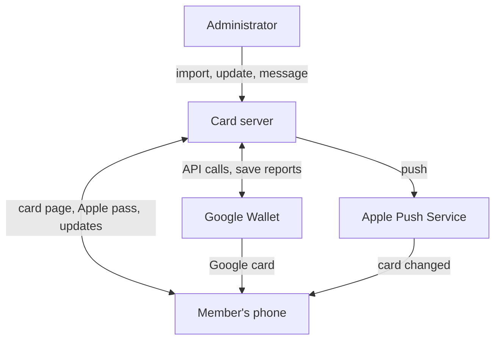

**The lifecycle, briefly.** An administrator imports the member list. Each member gets a personal link by email. Opening it shows a page with two buttons, one per wallet:

- **Apple Wallet:** the server builds and signs a card file, and the iPhone adds it.
- **Google Wallet:** the server creates the card through Google's API, and sends the member to Google's "save" page.

From then on, the server can change the card, send messages to it, and learn whether the member kept it.

### Design goals

1. **No app, no account.** A link and one tap. Everything else is the wallet's job.
2. **One card per member per wallet.** Each card has a stable identity derived from the member's ID. A repeat download *replaces* the card instead of adding a second one, and the server can always find it again to update it.
3. **Cards stay current.** When a member's details change, the card on their phone changes too, with no new download.
4. **Know what's really in wallets.** "Downloaded" and "added to a wallet" are different numbers, and only the wallets know the second one. The system records what each wallet reports, and checks again every night.
5. **Messages are safe to send.** Every send is previewed and confirmed, respects the platforms' limits, can target a region, and can be tested on a single card first.
6. **Secrets never ship in the code.** Signing certificates and keys are supplied at runtime, never built into the application.
7. **Testable without credentials.** The whole system, including signing and both wallet APIs, runs under automated tests with generated test certificates and mocked services.

## The Apple Wallet pass system

### What an Apple pass is

An Apple Wallet pass is a `.pkpass` file: a ZIP archive containing:[^apple-build]

- **`pass.json`:** the card's content, layout, colours and barcode.
- **Images:** the logo, icon and strip, each at 1x, 2x and 3x. Every pass needs an icon, which Wallet also shows in notifications, including on the lock screen.[^apple-source]
- **Localization folders** (`en.lproj/` and so on), each with a `pass.strings` file. Labels in `pass.json` are keys looked up in the strings file for the phone's language, so one pass can show in several languages. Images can be localized the same way, but an image with the same name at the top level of the pass overrides every localized version.[^apple-source]
- **`manifest.json`:** the SHA-1 hash of every other file.
- **`signature`:** a detached PKCS #7 signature of the manifest, made with the private key of the Pass Type ID certificate.

The signature uses a **Pass Type ID certificate** from the Apple Developer portal, together with Apple's **WWDR intermediate certificate**. The intermediate must be the generation that issued your certificate. Apple's table of intermediates lists Pass Type ID certificates under G4, the generation for "features supported by Apple Push Notification service".[^apple-wwdr] An expired or mismatched intermediate is a classic cause of "this pass is invalid".

The system makes three checks when it starts, so a broken configuration fails before any member sees it:

- the configured pass type matches the certificate;
- the intermediate matches the certificate;
- the private key matches the certificate and its password.

### Identity and authentication

Every pass carries four identifiers:

- **`passTypeIdentifier`**, such as `pass.com.example.members`. It must match the signing certificate.
- **`serialNumber`**, such as `MEMBER-<member id>`. It's stable, so a re-download replaces the card and updates can find it. In Apple's words, adding a pass with the same pass type identifier and serial number as one already on the device "overwrites the old one".[^apple-build]
- **`authenticationToken`**, a random value kept for the life of the pass. Devices present it when they talk to the server.
- **`webServiceURL`**, the address where devices register and fetch updates. It must use HTTPS in production; plain HTTP is allowed only for testing.[^apple-web-service]

Rebuilding a member's pass reuses the same serial number and token, so devices that already hold it keep working. Apple requires this: an update can change anything in a pass "except for the authentication token and the serial number".[^apple-web-service] A changed token would also lock out devices that never received the update, since updates aren't guaranteed to arrive.[^apple-guide-updating]

### Issuing a pass

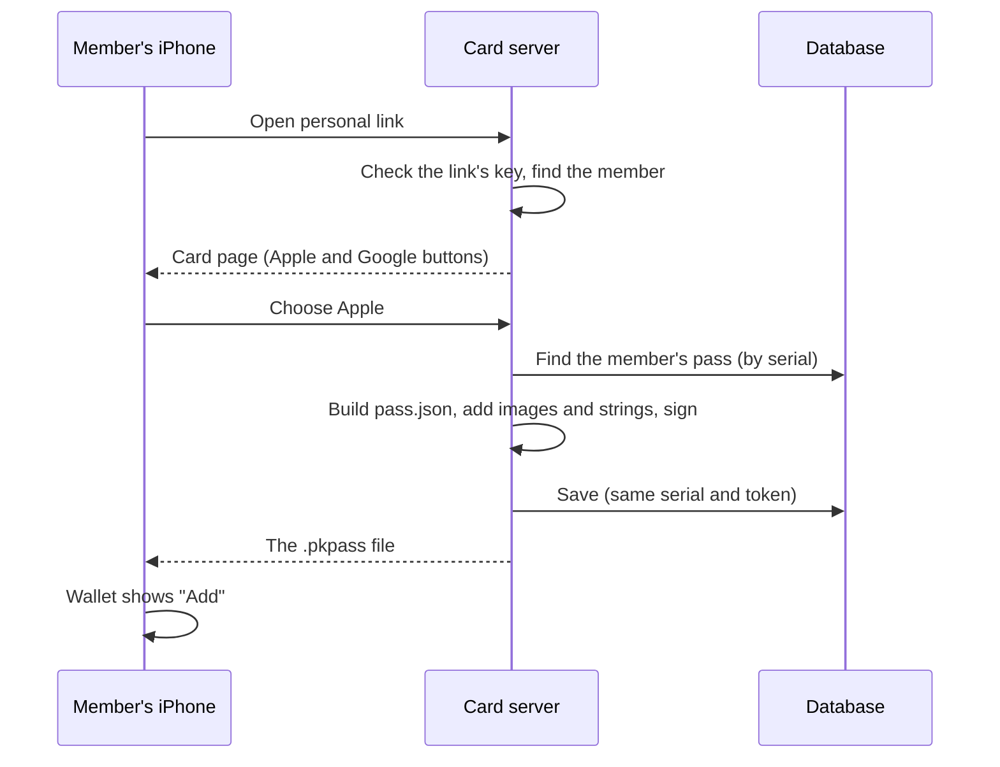

### Keeping passes updated: the web service and push

Apple's update model has three steps. The device **registers** with your server. Your server sends a **push** when a pass changes. Then the device **pulls** the new version. The push carries no data, only an empty JSON dictionary, so it just means "check in".[^apple-web-service] Apple's older Wallet guide explains why: push notifications "are not guaranteed to be delivered", and several from the same source can be coalesced into one, so anything carried in the push could be lost.[^apple-guide-updating]

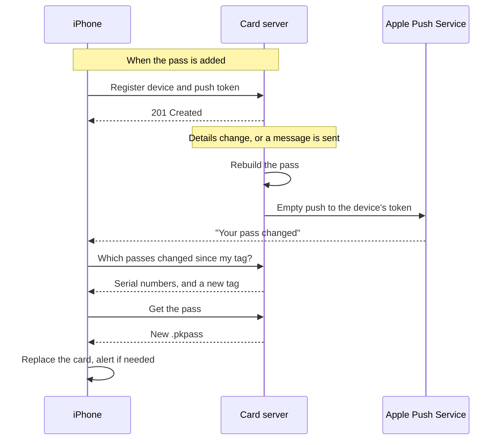

Apple defines the endpoints, under `/v1/` beneath the pass's `webServiceURL`:[^apple-endpoints]

- **Register:** `POST /v1/devices/{device}/registrations/{passType}/{serial}`, with the header `Authorization: ApplePass {token}` and the push token in the body. The server answers `201`, or `200` if the device had already registered that pass.
- **Unregister:** a `DELETE` to the same path, with the same header, when the pass is removed.
- **What changed:** `GET /v1/devices/{device}/registrations/{passType}?passesUpdatedSince={tag}`. The server answers with the changed serial numbers and a new tag, or `204` if nothing changed. This call carries no pass token; the device library ID is the shared secret.[^apple-web-service]
- **Get the pass:** `GET /v1/passes/{passType}/{serial}`, with the `Authorization` header, answered with the new `.pkpass`.
- **Log:** `POST /v1/log`, where devices send their own error messages. It's invaluable when debugging.

Lessons from building it:

- **Pushes use the pass certificate itself.** No separate push key is needed: Apple says the push "uses the same certificate and private key that the creator of the pass used to sign the original". The pass type identifier is the push topic. Pass pushes only work in Apple's *production* push environment, not the sandbox.[^apple-web-service]
- **Retire dead tokens.** Apple says to delete a device when the push service reports that its token is invalid.[^apple-web-service] The push service answers `410` (`Unregistered` or `ExpiredToken`) for a token that's no longer active, and `400` with `BadDeviceToken` for an invalid one, and says not to retry either.[^apple-apns-errors] (`BadDeviceToken` can also mean the push went to the wrong environment: one more reason to send pass pushes only to production.) Delete that registration, and if no other device holds the card, record it as no longer in a wallet (see [Proving cards are in wallets](#proving-cards-are-in-wallets-and-why-notifications-depend-on-it)).
- **Return every change since the tag.** Apple says to select "the passes that have been updated since your web service provided the `updated` tag, or all passes when there's no tag".[^apple-web-service] That means *every* pass updated since the device's tag, not only the passes at the single latest timestamp. An early library got this wrong and had to be replaced.
- **Make the update tag URL-safe.** The `lastUpdated` tag is an opaque value the device sends back in a query string. An ISO timestamp like `…+00:00` comes back as `… 00:00`, because `+` means a space in a query string, and then parses as midnight. Integer microseconds since the epoch avoid the problem. Apple defines `lastUpdated` as "a developer-defined string", and its own example is a Unix time in seconds, `"1351981923"`.[^apple-endpoints] Keep it short, too: Apple's older guide warns that the serial number, pass type identifier and tag all end up in URLs, and that long values can break systems that limit URL length.[^apple-guide-updating]
- **Never push from inside a database save.** One library pushed synchronously every time a pass record was saved. As soon as a device registered, a re-download raised an error and rolled back. Push explicitly, in batches, from background jobs.

### Messages and lock-screen alerts

A pass field can carry a `changeMessage` such as `"%@"`. When an update changes that field's value, Wallet shows the message on the lock screen, with `%@` replaced by the new value. The format string must contain `%@`, and without a `changeMessage` there's no alert.[^apple-field] The system uses one back-of-card field, `message`, for this.

Two non-obvious rules shape the design:

- **Wallet only alerts on a change to a field the pass already had.** Apple's older guide describes how alerts work: the device "compares the latest version of the pass against the version it had before to determine which fields have changed".[^apple-guide-updating] A field that's new has no earlier value to compare, and in practice, if the field first appears along with the first message, that message arrives silently. So every pass is issued with the field from day one, showing a placeholder such as "No messages yet".
- **Only deliberate sends should alert.** Ordinary rebuilds, after a data change or a re-download, put the latest message back *without* a `changeMessage`. Otherwise an unrelated update could alert members again with an old message. Apple also warns that change messages "interrupt the user", and suit only time-sensitive information.[^apple-guide-updating]

## The Google Wallet pass system

### Classes, objects and issuers

Google Wallet's **generic pass** has two layers:[^google-object]

- **A class:** the template shared by every card, with an ID such as `<issuer id>.MEMBERSHIP`.
- **An object:** one member's card, with an ID such as `<issuer id>.MEMBER_<member id>`.

The organization has a Google Wallet **issuer account**. The server authenticates as a **service account** with the `wallet_object.issuer` scope.[^google-auth] One service-account key does both jobs: it signs "save" links and calls the REST API.

A generic object holds:

- the card's title, header and subheader, each a localized string (a default language plus translations);
- a barcode;
- hero and logo images, loaded from public URLs;
- a background colour;
- a `genericType` and a `state`.

### Issuing a card: the API first, then a link

There are two ways to hand a card to a member:[^google-jwt]

- **A "fat" save link:** a signed JWT that contains the whole object. It's simple, but the object only exists once the member taps Save, and the link grows with the card's content.
- **An API object plus a short link:** insert the object through the REST API first, then sign a JWT that carries only `{id, classId}`.

The system uses the second, so every card exists on Google's side and can be updated. The fat link stays as an automatic fallback in case the API call fails, so a member is never left without a card.

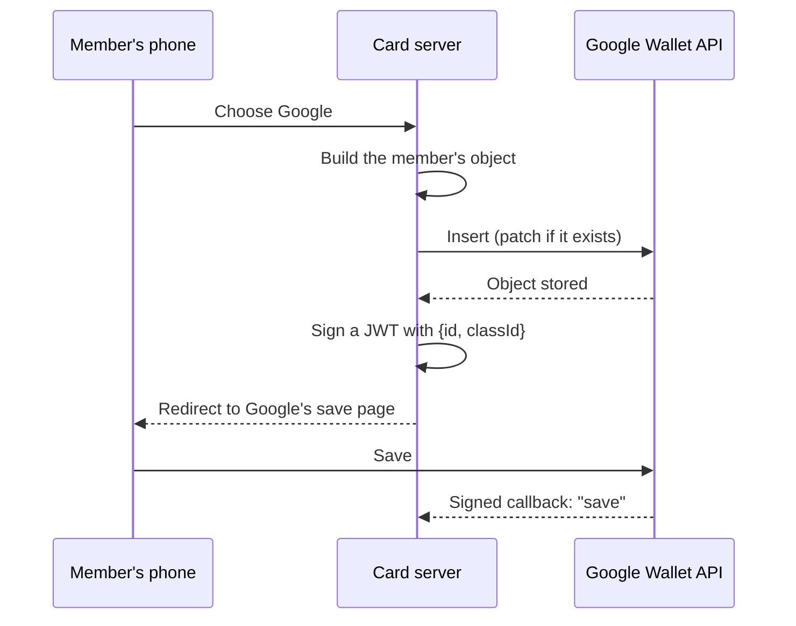

Lessons:

- **The REST API is stricter than save links.** A `genericType` of `GENERIC_TYPE_OTHER` was always accepted in save links. Once creation moved to the API, every insert failed with a `400`, because the valid value is `GENERIC_OTHER`.[^google-object] Check every enum against the API's discovery document, and pin it with a test.
- **Updates are patches.** A patch changes only the fields you send, so saved cards update in place, with no push needed. Patching also keeps the messages already on the card.

### Messages and notifications

Messages are added with `addMessage`:

- **On the class:** the message reaches every saved card of that class, including cards saved later. This suits an announcement to everyone.
- **On an object:** the message reaches one card. This suits regional or individual messages.

A message with `messageType: TEXT_AND_NOTIFY` also raises an Android notification. Two platform limits apply:[^google-notify][^google-object]

- **At most 3 notifying messages per card in 24 hours.** More return a `QuotaExceededException`. The system blocks a send that would go over the limit. If Google still refuses a card, the system resends that card's message as plain `TEXT`, which shows on the card without a notification.
- **At most 10 messages per card or class.** The system trims the oldest before adding a new one.

### Knowing whether a card was saved: signed callbacks

Google can `POST` a **callback** to your server whenever a member saves or deletes a card of your class.[^google-callbacks] Three requirements are easy to miss:

1. **The class must name the URL.** Set `callbackOptions.url` on the class, with a one-time patch. Until then Google sends nothing; a missing URL is the most likely reason saves go unreported.
2. **Googlebot must be allowed to reach it.** Google's API reference says the callback URL's path must be allowed for Googlebot in `robots.txt`.[^google-callback-options]
3. **Every callback must be verified.** The body is a signed message using Google Pay's **ECv2SigningOnly** protocol. Google recommends its Tink library, which does the whole check.[^google-callbacks] Without it, the steps are:

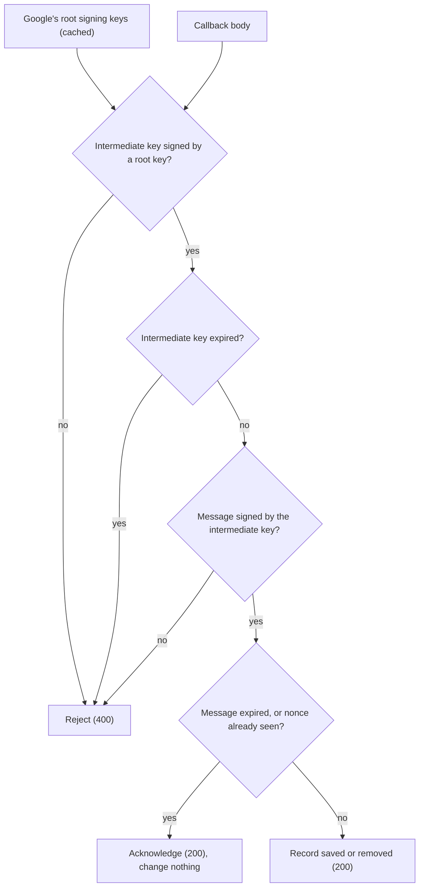

In each signature check, the signed data is built from length-prefixed values: a 4-byte little-endian length, then the UTF-8 bytes. The intermediate key's signature covers the sender ID (`GooglePayPasses`), the protocol and the signed key. The message's signature covers the sender ID, the recipient (your issuer ID), the protocol and the signed message. Signatures are ECDSA on P-256 with SHA-256.

The decoded message carries `classId`, `objectId`, `eventType` (`save` or `del`), `expTimeMillis` and a `nonce`. Delivery is best effort and can repeat, so store the nonce to drop duplicates.[^google-callbacks]

As a safety net, a nightly job reads each object's `hasUsers` flag, which Google sets while anyone holds the card, and corrects the records.[^google-object]

## Integrated pass management

The two wallets work differently, so the system puts one data model and one set of workflows over both.

### Data model

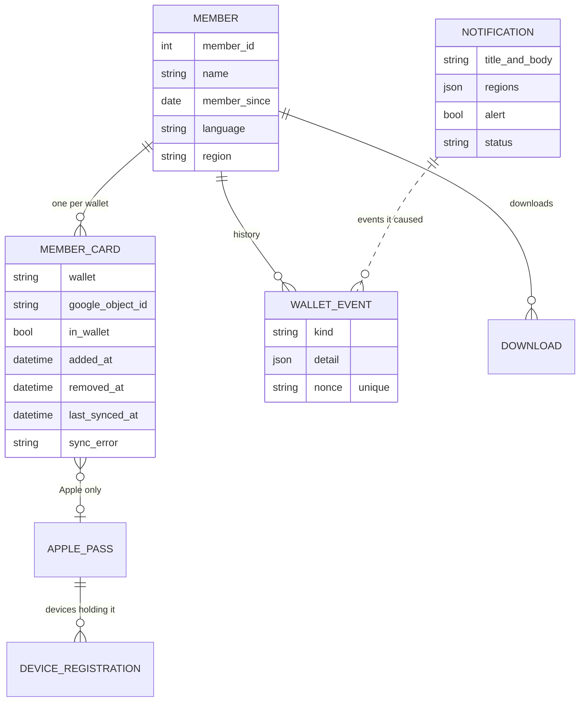

Each card record says which wallet it's in, Apple or Google. A wallet event's kind is one of issued, added, removed, updated, notified or failed, and its unique `nonce` lets duplicate Google callbacks be dropped. A notification with no regions goes to everyone, and its status moves from draft to sending, then sent or failed.

One rule keeps the records trustworthy: **every change to "is this card in a wallet?" goes through a single function.** [Proving cards are in wallets](#proving-cards-are-in-wallets-and-why-notifications-depend-on-it), below, explains how that works and why notifications depend on it.

### Importing members and targeting regions

Members arrive as a spreadsheet export from the organization's membership database, imported through an admin screen. The import:

- **cleans values,** such as numbers with thousands separators and the export's own date format;
- **rejects the whole import** if any row is malformed, inside one database transaction, and the preview shows why;
- **derives each member's region** from their address, so messages can target regions. A bad address never rejects a row; that member just has no region;
- **leaves stored addresses alone** when an export has no address columns;
- **detects card changes:** it compares what each member's card *shows* (name, member-since date, member number, language, region) before and after the import, and queues a wallet update for exactly those members.

### Updating cards already in wallets

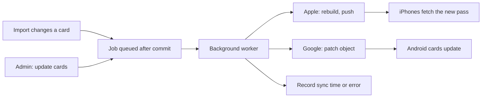

Updates run as background jobs. They're queued only after the database transaction commits, so the worker never reads uncommitted data. One member's failure is recorded on their card and doesn't stop the batch. Give bulk jobs a generous time limit: a short default limit can cut a large send off part-way.

### Sending notifications

```mermaid
stateDiagram-v2
    accTitle: The life of a notification
    accDescr: An administrator writes a draft with a title and message, picks regions, and chooses an alert or a silent update. The draft shows its reach in each wallet. Confirming starts sending, unless it would exceed Google's alert limit. The worker delivers to both wallets; the notification ends as sent, or as failed if nothing was delivered.
    [*] --> Draft: write, pick regions, alert or silent
    Draft --> Draft: preview reach per wallet
    Draft --> Sending: confirm (blocked if over Google's limit)
    Sending --> Sent: delivered to both wallets
    Sending --> Failed: nothing delivered
    Sent --> [*]
```

When a send is confirmed:

- **Apple:** every targeted card that's in a wallet is rebuilt with the message in its `message` field, and pushed.
- **Google, to everyone:** one message on the class.
- **Google, to selected regions:** one message on each targeted card.

The notification stores counts for each wallet: cards targeted, updated, pushed, sent, failed, over quota and skipped. New downloads and later rebuilds show the member's latest message, silently.

**Test sends** use the same delivery for a handful of chosen cards, such as one member's cards or a single card. They go out immediately, are limited to a few cards, and are logged as tests in the card history rather than as notifications. The Apple text includes a timestamp, so a repeated test still changes the field, and still alerts.

### Adoption statistics

An admin page answers "how many members actually have the card?", region by region:

- members;
- Apple: downloads, cards in a wallet, and devices;
- Google: links opened, cards in a wallet, and cards removed;
- adoption rates, and the last 30 days of activity.

"In a wallet" means the wallet itself confirmed it. The next section explains what counts as proof.

## Proving cards are in wallets, and why notifications depend on it

A download isn't an installed card. A member can tap the Apple button and dismiss the "Add" sheet, open the Google save page and close it, or add the card and delete it a week later. If the system treated every download as a card on a phone, it would report adoption it doesn't have, promise administrators an audience that isn't there, and spend pushes and Google's limited alert quota on phones that will never show them.

So the system keeps two separate facts for every member and wallet:

- **Issued:** the member downloaded the Apple card or opened the Google save link. The server knows this on its own.
- **In a wallet:** the wallet itself confirmed it holds the card. Only Apple's devices and Google's servers can say this, and the system records it only when they do.

Everything sent to a member's phone after the first download, and every reach count and statistic, is based on the second fact.

### What counts as proof

The system never infers "in a wallet". It records it only from evidence that comes from the wallet side, which the member's browser or a third party can't produce.

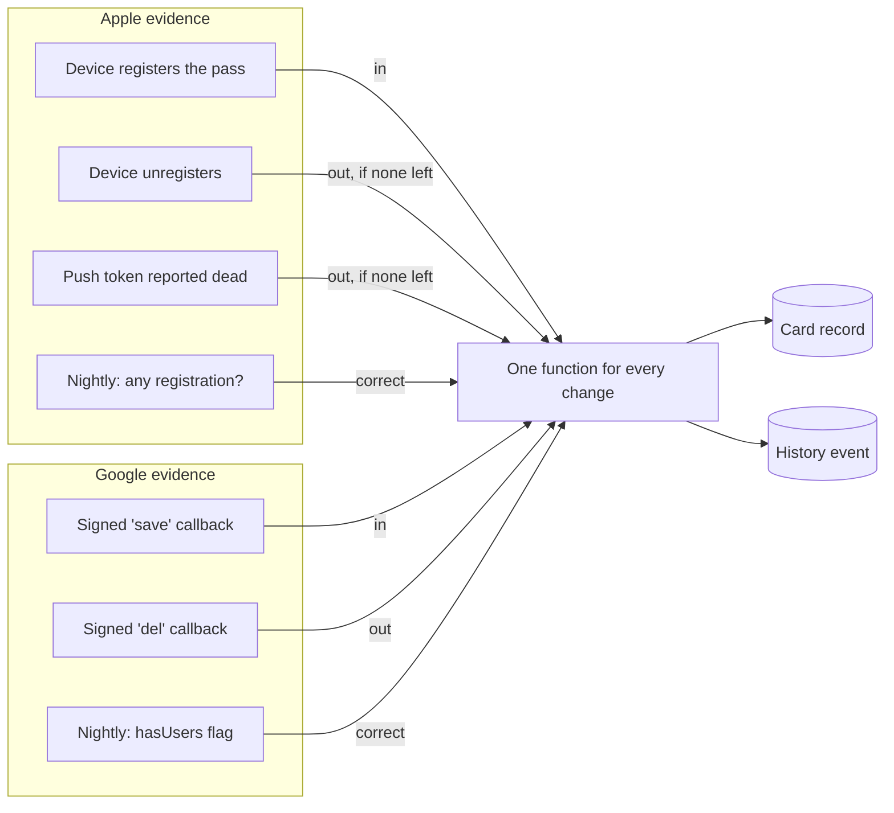

**Apple: device registration.** When an iPhone adds a pass that has a `webServiceURL`, Wallet registers it with the server.[^apple-web-service] It sends:

- its device library ID;
- its push token;
- the pass's `authenticationToken`, in the `Authorization: ApplePass …` header.

The token is random, unique to that member's pass, and exists only inside the signed pass file. A request carrying it is therefore proof that a device holds that exact pass. The server treats an Apple card as in a wallet **while at least one device is registered** for it, since one member may carry it on both a phone and a watch. It counts the card as removed when the last device unregisters, or when Apple's push service reports that the last device's token is gone (`410` or `BadDeviceToken`).

**Google: signed callbacks.** When a member saves or deletes a card of the organization's class, Google sends a message to the class's callback URL. That message is signed: Google's root keys sign an intermediate key, and the intermediate key signs the message, whose signed data names the organization's issuer ID as the recipient. The server accepts the message only if both signatures check out, neither the key nor the message has expired, and its nonce hasn't been seen before. A forged or replayed "save" therefore can't mark a card as added. The steps are in [Knowing whether a card was saved](#knowing-whether-a-card-was-saved-signed-callbacks), above.

**Both: a nightly re-check.** Callbacks are best effort, and devices can disappear without saying goodbye, so a scheduled job re-checks the truth once a day:

- **Apple:** in a wallet if any device registration exists for the member's pass.
- **Google:** in a wallet if the object's `hasUsers` flag is true. Google's platform sets that flag, not the system.[^google-object]

The re-check also fills in cards that were saved before tracking existed, or while callbacks weren't configured. Its first run is worth watching: it can find saved cards that were never reported.

### One gate, with a history

Registrations, unregistrations, dead tokens, callbacks and the nightly re-check all go through a single function, which:

1. compares the reported state with the stored one;
2. does nothing if it's unchanged, so duplicate callbacks and agreeing re-checks add no noise;
3. if it changed, updates the card's "in a wallet" flag, and stamps the time it was added or removed;
4. appends a history event recording **what changed, and which evidence said so**: an Apple registration, a dead push token, a Google callback (with its nonce), or the nightly re-check.

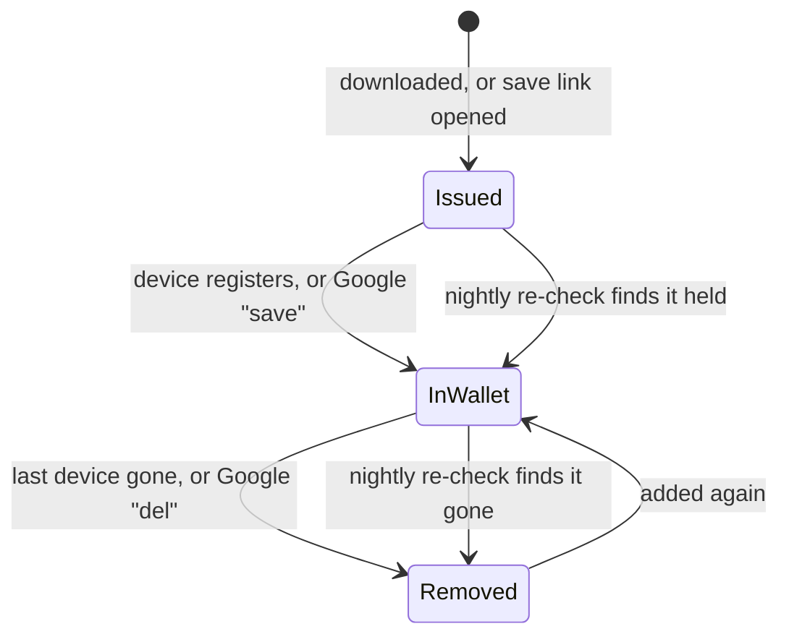

Because every change is logged with its source, an administrator can answer "how do we know this member has the card?" for any member, with a date and the evidence behind it.

### How certain is "in a wallet"?

- **Apple device registration** is strong evidence: it's authenticated with the pass's secret token. But it only happens if the device can reach the web service. A pass built with the wrong `webServiceURL`, or a phone that can't reach the server, never registers.
- **A rejected push token** is strong evidence that a device removed the card, but the system only learns it when it tries to push.
- **A Google signed callback** is strong evidence: it's signed by Google, expires, and is deduplicated. But delivery is best effort, and nothing is sent until the class's callback URL is set.
- **Google's `hasUsers` flag** is authoritative, because Google sets it. But it's read once a night, so it can be up to a day behind.

One gap is deliberate. An iPhone that adds a card but never registers is counted only as **issued**. The system would rather under-report than claim an audience it can't reach. Such a phone can't receive updates or messages either, so "not in a wallet" is the honest answer.

### Why good notifications are built on this

Every part of the notification workflow reads the same "in a wallet" fact.

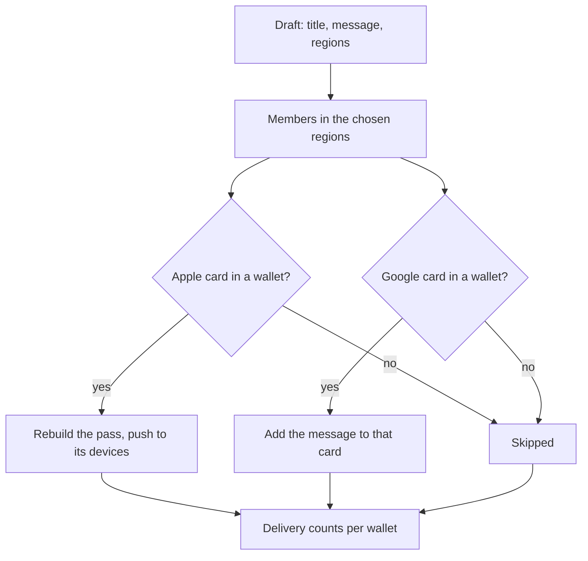

- **An honest preview.** Before anything is sent, the admin sees how many members are targeted, and how many of their Apple and Google cards are *in wallets*. That's the real reach, not the number of people who once clicked a link.
- **Messages go only where they can arrive.** Apple pushes go only to registered devices, which are the only ones that can receive them. Google messages to individual cards go only to saved cards. A message to everyone is a single class message, which reaches every saved card. Nothing is spent on cards that were never added, or were removed.
- **Rate limits are protected.** Google allows three notifying messages per card in 24 hours. Sending only to cards that are really held, and blocking a send that would go over the limit, saves the quota for messages members will actually see.
- **The results add up.** Each notification stores what happened in each wallet: targeted, updated, pushed, sent, failed, over quota and skipped. Because "targeted" means "confirmed in a wallet", those numbers describe real phones. A gap between targeted and delivered is a real delivery problem, not noise from abandoned downloads.
- **Segments stay meaningful.** "Send to members in region X" reaches the members in region X who actually carry the card. The statistics page shows the same number for each region before anyone decides to send.
- **Delivery feeds back into the evidence.** A push that Apple rejects for a dead token updates the card's state immediately, so the next notification's preview is more accurate than the last.

### Checking it yourself

Administrators can check the whole chain without touching the server:

1. **The statistics page:** for each region, compare "downloaded" with "in a wallet". A large gap points to members who never finished adding the card, or to a configuration problem: Apple cards not registering, or Google callbacks not set up.
2. **A card's history:** for any member, see when the card was issued, added and removed, and which evidence recorded each change.
3. **A test send:** send a test message to your own card. The admin reports, for each wallet, whether it was targeted, pushed or sent, or skipped because the card isn't in a wallet. Your phone confirms the rest.

If all three agree, the system's view of who carries the card, and so of who a notification will reach, matches reality.

## Architecture and storage

The system is a conventional web application with background workers. Nothing in it depends on a particular cloud.

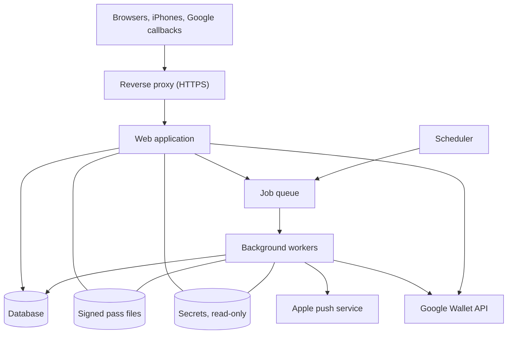

- **Processes:** one codebase runs as the web application, the background workers and the scheduler. The job queue also holds a small cache, including Google's root signing keys. The reverse proxy terminates HTTPS and renews its certificates.
- **Database:** a relational database holds members, card records and their history, downloads, notifications, device registrations and the scheduler's settings.
- **Files:**
  - Signed `.pkpass` files are stored on disk, one current file per member's Apple card. A clean-up task removes stale ones.
  - Apple card artwork ships with the application.
  - Google card images are served from public URLs, because Google fetches them.
- **Secrets:** the Apple certificate, its key and the WWDR intermediate, plus the Google service-account key, are mounted read-only at runtime. They're never part of the application build. Everything else, such as IDs and URLs, comes from configuration. Apple's older guide goes further: it advises against keeping the signing key on the web server at all, because web servers "typically have a larger attack surface", and suggests signing passes on a separate server.[^apple-guide-updating] For a small system that's a trade-off; the read-only mount is the minimum.
- **Public endpoints:** three kinds of visitors need to reach the server: members opening the card page, iPhones calling the Apple web service, and Google delivering callbacks. The admin screens are restricted to staff.

What's stored, and where:

- **Member details** (name, IDs, language, region): the database, from the import.
- **Card records, history and notifications:** the database. They grow over time, so plan a retention policy.
- **Device registrations** (push tokens): the database. They're removed when a device unregisters, or when Apple's push service rejects the token.
- **Signed Apple passes:** file storage, one current file per member.
- **Google cards:** Google's servers. The system keeps only each object's ID, and updates the cards through the API.
- **Signing keys:** the read-only secrets mount. Back them up separately and securely.

## Running it on your own hardware

The whole system, database included, can run in containers on a single ordinary server on your own premises. Two things are easy to overlook.

**On-premises doesn't mean offline.** iPhones must reach the Apple web service, and Google must reach the callback URL, over the internet, with a valid HTTPS certificate. That needs a public DNS name for the server and inbound HTTPS. The server must also make outbound HTTPS connections to Apple's push service and Google's APIs.

**The accounts own the cards.** A card on a phone belongs to the Apple Pass Type ID and the Google issuer account that created it. Moving the *server* is invisible to members, as long as the accounts and the public URL stay the same. Moving to *different* accounts means every member has to download their card again.

### What you need

- **Wallet accounts:**
  - an Apple Developer account with a Pass Type ID certificate, which expires and has to be renewed;
  - a Google Wallet issuer account with an approved class, and a service account with the Wallet API enabled.
- **A server** that can run containers, with a public HTTPS name as described above.
- **Someone to run it,** comfortable with containers, the database and the web framework.

### Going live

1. **Configure** the application: the wallet IDs, the public web service and callback URLs, and the secret keys that protect members' personal links.
2. **Install the secrets** where only the application can read them.
3. **Start the stack and run the startup checks,** which confirm that the Apple certificate, key and intermediate fit together, and that the Google key can be read.
4. **Register the callback URL** on the Google class, once per class.
5. **Import the members.**
6. **Test end to end** on an iPhone and an Android phone:
   - add both cards, and confirm the admin shows each as "in a wallet";
   - change a member's details, and confirm both cards update;
   - send a test notification with an alert, and confirm it appears on both phones;
   - remove a card, and confirm it's reported as removed.

### Keeping it running

- **Backups:**
  - the database, every night, copied off the server;
  - the signing keys, stored separately and encrypted;
  - the pass files are optional, because passes are rebuilt on the next download or update.
- **Certificates:** renew the Apple Pass Type ID certificate before it expires. Apple says that if it expires, passes already installed "will continue to function normally", but "you'll no longer be able to sign new passes or send updates to existing passes". Revoking is worse: "If your certificate is revoked, your passes will no longer function properly." So create the new certificate and switch to it, and never revoke the old one to make way.[^apple-certs]
- **Monitoring:** error reports from the web application and workers, the devices' messages to `/v1/log`, and the nightly check's results, which also show whether Google's API is reachable.
- **Restore drill:** now and then, restore a database backup into a fresh database, and start the system against it. Cards on phones keep working as long as the public URL and the wallet accounts don't change.

## References

[^apple-build]: Apple Developer Documentation, "Building a pass." <https://developer.apple.com/documentation/walletpasses/building-a-pass>
[^apple-wwdr]: Apple Developer, "WWDR intermediate certificates." <https://developer.apple.com/help/account/certificates/wwdr-intermediate-certificates/>; and Apple Developer, "Create Wallet identifiers and certificates." <https://developer.apple.com/help/account/capabilities/create-wallet-identifiers-and-certificates/>
[^apple-web-service]: Apple Developer Documentation, "Adding a web service to update passes." <https://developer.apple.com/documentation/walletpasses/adding-a-web-service-to-update-passes>
[^apple-field]: Apple Developer Documentation, "PassFieldContent" (`changeMessage`). <https://developer.apple.com/documentation/walletpasses/passfieldcontent>
[^apple-source]: Apple Developer Documentation, "Creating the source for a pass." <https://developer.apple.com/documentation/walletpasses/creating-the-source-for-a-pass>
[^apple-endpoints]: Apple Developer Documentation: "Register a pass for update notifications" <https://developer.apple.com/documentation/walletpasses/register-a-pass-for-update-notifications>; "Unregister a pass for update notifications" <https://developer.apple.com/documentation/walletpasses/unregister-a-pass-for-update-notifications>; "Get the list of updatable passes" <https://developer.apple.com/documentation/walletpasses/get-the-list-of-updatable-passes>; "Send an updated pass" <https://developer.apple.com/documentation/walletpasses/send-an-updated-pass>; "Log a message" <https://developer.apple.com/documentation/walletpasses/log-a-message>; and "SerialNumbers" <https://developer.apple.com/documentation/walletpasses/serialnumbers>
[^apple-guide-updating]: Apple, *Wallet Developer Guide* (archived, 2018), "Updating a Pass." <https://developer.apple.com/library/archive/documentation/UserExperience/Conceptual/PassKit_PG/Updating.html>
[^apple-apns-errors]: Apple Developer Documentation, "Handling notification responses from APNs." <https://developer.apple.com/documentation/usernotifications/handling-notification-responses-from-apns>
[^apple-certs]: Apple Developer, "Certificates overview" (expired or revoked certificates). <https://developer.apple.com/help/account/certificates/certificates-overview/>
[^google-object]: Google Wallet API reference, "GenericObject" (`genericType`, `messages`, `hasUsers`). <https://developers.google.com/wallet/reference/rest/v1/genericobject>
[^google-callback-options]: Google Wallet API reference, "CallbackOptions" (set on the class). <https://developers.google.com/wallet/reference/rest/v1/CallbackOptions>
[^google-auth]: Google Wallet, "Authentication" for the REST API. <https://developers.google.com/wallet/generic/getting-started/auth/rest>
[^google-jwt]: Google Wallet, "Generic pass: JWT" (save links). <https://developers.google.com/wallet/generic/use-cases/jwt>
[^google-notify]: Google Wallet, "Generic pass: Trigger push notifications." <https://developers.google.com/wallet/generic/use-cases/trigger-push-notifications>
[^google-callbacks]: Google Wallet, "Generic pass: Use callbacks for saves and deletions." <https://developers.google.com/wallet/generic/use-cases/use-callbacks-for-saves-and-deletions>
